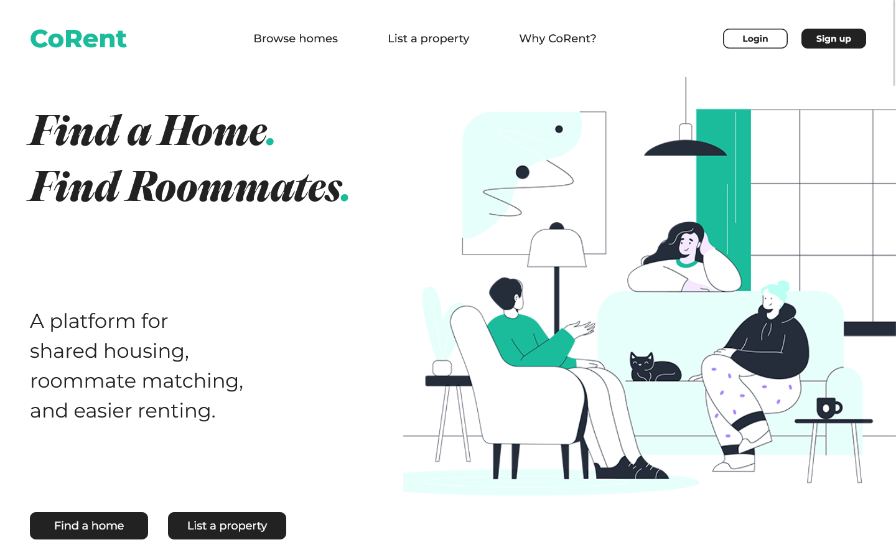
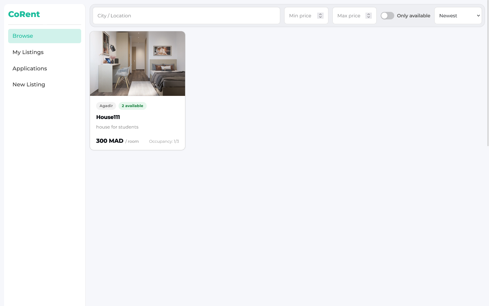
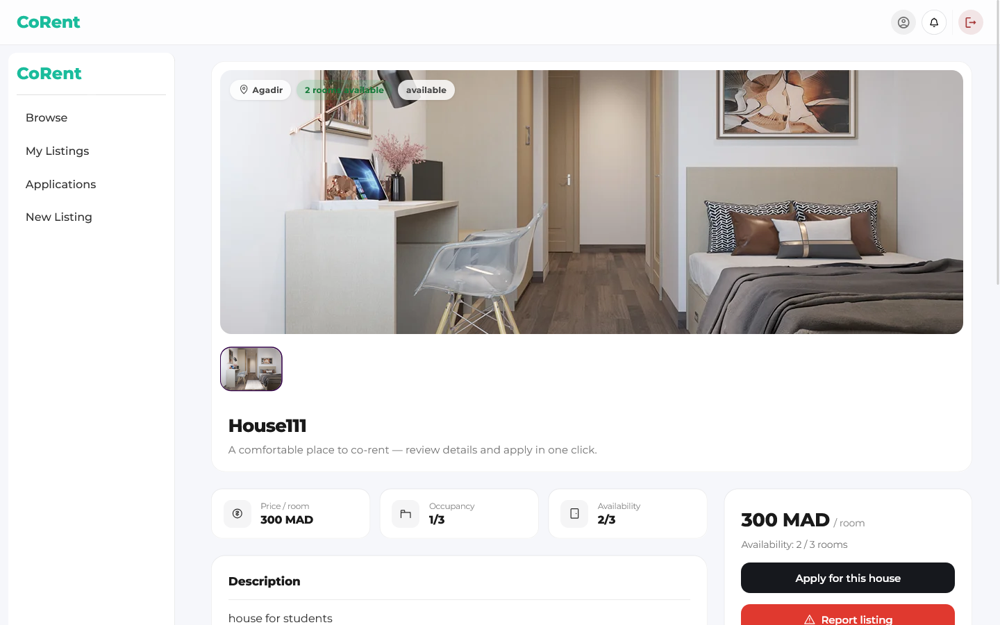
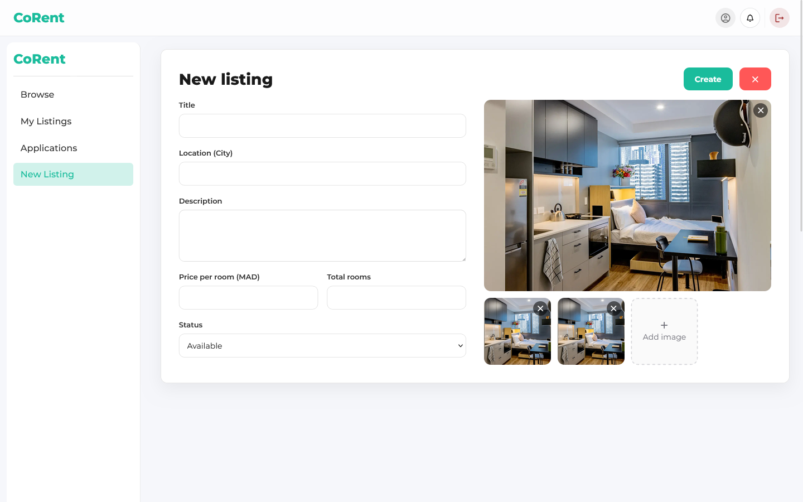
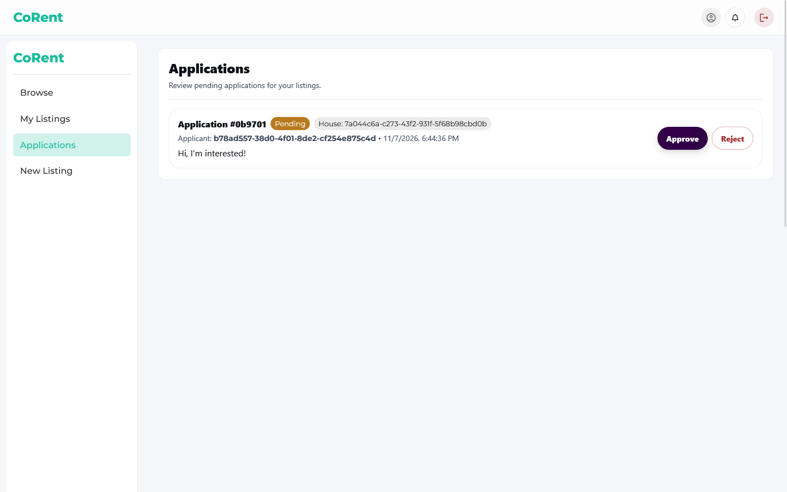
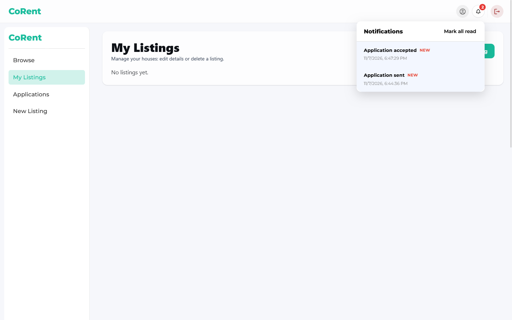
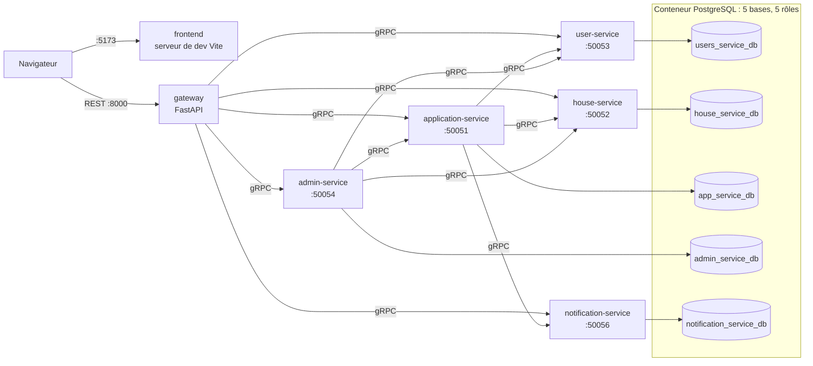

# CoRent

**Une plateforme de colocation qui met en relation des étudiants à la recherche d'un logement et des propriétaires à la recherche de locataires.**

CoRent est un projet full-stack en architecture microservices : un frontend React, une passerelle REST FastAPI, cinq services backend communiquant en gRPC, et une base PostgreSQL par service. L'ensemble se lance en local avec Docker Compose.

> **Statut du projet.** CoRent est né d'un projet universitaire réalisé à cinq pour un module de systèmes distribués. Il a ensuite été repris par un seul auteur (frontend reconstruit, backend restructuré, dépôt nettoyé, ajout de Docker). C'est un **projet de portfolio pour le développement local**, pas un service de production. Voir [Limites connues](#limites-connues).

[English](README.md) | [Français](README.fr.md)

## Captures d'écran

| Page d'accueil | Parcourir les logements |
|---|---|
|  |  |

| Détail d'un logement | Créer une annonce |
|---|---|
|  |  |

| Le propriétaire examine les candidatures | Notifications |
|---|---|
|  |  |

D'autres écrans (connexion, inscription, candidature) se trouvent dans [`docs/screenshots/`](docs/screenshots/).

## Pourquoi CoRent

Trouver un logement est difficile, coûteux et incertain, surtout à la rentrée universitaire. CoRent vise à faciliter cette recherche : les propriétaires publient des chambres dans une maison partagée, les étudiants parcourent les annonces et postulent, et les propriétaires acceptent ou refusent les candidatures.

## Fonctionnalités

| Fonctionnalité | Statut |
|---|---|
| Inscription (formulaire en 3 étapes) et connexion | Vérifié dans Docker |
| Créer une annonce (avec des URL d'images) | Vérifié dans Docker |
| Parcourir les annonces ; les voir depuis un autre compte | Vérifié dans Docker |
| Postuler à une annonce ; le propriétaire approuve | Vérifié dans Docker |
| Notifications dans l'application (« Application sent », « Application accepted ») | Vérifié dans Docker, voir les [limites](#limites-connues) |
| Modifier/supprimer une annonce, refuser une candidature, profil, filtres de recherche | Fonctionne selon l'auteur ; non retesté dans Docker |
| Signaler une annonce | Implémenté ; non retesté dans Docker |
| Tableau de bord admin, modération des annonces, bannissement d'utilisateurs | Accessible mais **bogué** (signalé par l'auteur) ; non testé dans Docker |

« Vérifié dans Docker » signifie testé manuellement dans le navigateur sur la stack Compose (novembre 2026). Il n'y a pas de suite de tests automatisés (voir [Tests](#tests)).

## Technologies

- **Frontend :** React 19, Vite 7, Material UI 7, React Router 7, axios, GSAP
- **Passerelle :** FastAPI (REST), qui appelle les services en gRPC
- **Services :** Django 6.0 (user, house, application, admin) et SQLAlchemy (notification), communiquant via gRPC et Protocol Buffers
- **Base de données :** PostgreSQL 16 (Docker), une base par service
- **Outillage :** Docker Compose ; Python 3.12 dans les conteneurs ; Node 22 pour le conteneur frontend

Les versions des dépendances sont figées service par service dans chaque `requirements.txt` et dans `frontend/package-lock.json`.

## Architecture



Le navigateur ne communique qu'avec le frontend et la passerelle. Les services gRPC et PostgreSQL ne sont accessibles qu'à l'intérieur du réseau Docker.

### Services

| Service | Stack | Port gRPC | Base de données | Responsabilité |
|---|---|---|---|---|
| `gateway` | FastAPI | HTTP 8000 | aucune | API REST pour le frontend ; transmet les appels aux services |
| `user-service` | Django | 50053 | `users_service_db` | Comptes, authentification (JWT), profils |
| `house-service` | Django | 50052 | `house_service_db` | Annonces et leurs URL d'images |
| `application-service` | Django | 50051 | `app_service_db` | Candidatures, acceptation/refus ; appelle les services user, house et notification |
| `admin-service` | Django | 50054 | `admin_service_db` | Opérations d'administration (modération, bannissement d'utilisateurs) |
| `notification-service` | SQLAlchemy | 50056 | `notification_service_db` | Stocke et sert les notifications |
| `frontend` | React + Vite | HTTP 5173 | aucune | Interface utilisateur |

Les appels de service à service vers le user-service utilisent un secret partagé (`INTERNAL_GRPC_KEY`). Le trafic gRPC à l'intérieur du réseau Docker n'est pas chiffré.

## Démarrage (Docker)

### Prérequis

- Git
- Docker avec Compose v2 (Docker Desktop sous Windows/macOS, ou Docker Engine + le plugin Compose sous Linux)
- Python 3 ou OpenSSL, uniquement pour générer des secrets aléatoires

L'installation a été testée sous Windows avec Docker Desktop. Les autres plateformes n'ont pas été testées.

### 1. Cloner et configurer

```bash
git clone https://github.com/IJJ01/Corent.git
cd Corent
cp .env.example .env
```

Ouvrez `.env` et remplacez chaque `change-me` par une valeur aléatoire **différente**. Pour tout remplir automatiquement :

```bash
python - <<'EOF'
import secrets
out = []
for line in open(".env"):
    if "=" in line and not line.startswith("#"):
        line = line.split("=", 1)[0] + "=" + secrets.token_urlsafe(32) + "\n"
    out.append(line)
open(".env", "w").writelines(out)
EOF
```

`.env` est ignoré par Git. Ne le commitez jamais.

| Variable | Utilisée par |
|---|---|
| `POSTGRES_PASSWORD` | Superutilisateur PostgreSQL |
| `USER_DB_PASSWORD`, `HOUSE_DB_PASSWORD`, `APP_DB_PASSWORD`, `ADMIN_DB_PASSWORD`, `NOTIF_DB_PASSWORD` | Un rôle de base de données par service |
| `DJANGO_SECRET_KEY_USER`, `DJANGO_SECRET_KEY_HOUSE`, `DJANGO_SECRET_KEY_APPLICATION`, `DJANGO_SECRET_KEY_ADMIN` | Clé secrète Django de chaque service |
| `JWT_SECRET` | Signe les jetons de connexion (user-service) |
| `INTERNAL_GRPC_KEY` | Secret partagé pour les appels gRPC internes |

### 2. Démarrer

```bash
docker compose up -d --build --wait
docker compose ps
```

Le premier build télécharge les images de base et les paquets, et prend quelques minutes. Une fois terminé, les huit conteneurs doivent afficher `(healthy)`.

### 3. Utiliser l'application

| Quoi | URL |
|---|---|
| Application | http://localhost:5173 |
| Documentation de l'API REST (Swagger UI) | http://localhost:8000/docs |
| Vérification de santé de la passerelle | http://localhost:8000/health |
| Vérification gRPC passerelle vers user-service | http://localhost:8000/health/grpc |

Seuls le frontend et la passerelle sont exposés, et uniquement sur `127.0.0.1`. La base démarre **vide** : créez un compte depuis la page d'inscription.

### 4. Arrêter et redémarrer

```bash
docker compose stop          # arrête les conteneurs, conserve vos données
docker compose up -d --wait  # les redémarre
```

Les données sont stockées dans le volume nommé `corent_pgdata`.

> **Attention :** `docker compose down -v` supprime le volume de la base et toutes vos données. `docker compose down` seul supprime les conteneurs mais conserve les données.

## Initialisation de la base de données

Docker Compose s'en charge. Au **premier démarrage avec un volume vide**, PostgreSQL exécute deux scripts :

1. [`scripts/init_db.sql`](scripts/init_db.sql) crée les cinq bases.
2. [`docker/postgres/02-roles.sh`](docker/postgres/02-roles.sh) crée un rôle de connexion par service, propriétaire de sa propre base, avec `CONNECT` retiré à `PUBLIC`.

Ensuite, au démarrage des conteneurs :

- Les quatre services Django exécutent `manage.py migrate` (sans risque en cas de répétition ; cela ne réinitialise pas les données).
- Le notification-service crée sa table au démarrage avec `create_all` de SQLAlchemy. Une migration Alembic existe dans le dépôt mais n'est pas utilisée à l'exécution.

Remarques :

- PostgreSQL n'exécute les scripts d'initialisation qu'une seule fois. Si vous changez un `*_DB_PASSWORD` dans `.env` après le premier démarrage, les rôles existants gardent leur ancien mot de passe. Pour repartir de zéro, il faut supprimer le volume (`docker compose down -v`), ce qui efface vos données.
- Cinq bases sur un même serveur offrent une séparation **logique** (schémas distincts, pas de requêtes entre bases, un rôle par base). Elles n'offrent pas d'isolation des pannes ni des ressources. Pour cela, il faudrait cinq conteneurs PostgreSQL séparés.
- Aucune donnée de départ n'est créée, et la création d'un compte admin n'est pas couverte par cette installation.

## Workflow de développement

- Le conteneur `frontend` exécute le serveur de développement Vite mais ne monte pas le dossier source : toute modification du code nécessite un rebuild : `docker compose up -d --build frontend`.
- Pour le rechargement à chaud pendant le travail sur l'interface, lancez plutôt le frontend sur votre machine (non retesté après la migration vers Docker) :
  ```bash
  docker compose stop frontend
  cd frontend
  cp .env.example .env
  npm install
  npm run dev
  ```
- `python start.py` est le lanceur d'origine. Il fonctionne **uniquement sous Windows**, suppose des environnements virtuels locaux par service et un PostgreSQL local, et est conservé pour référence. Il ne fait pas partie de l'installation vérifiée.

## API et gRPC

- **REST :** la passerelle sert une documentation OpenAPI interactive sur http://localhost:8000/docs tant que la stack tourne. Groupes de routes : `/auth`, `/houses`, applications, `/me`, `/reports`, `/notifications`, `/admin`, `/admin/reports` et `/health`.
- **gRPC :** les contrats des services sont les fichiers Protocol Buffers de [`shared/protos/`](shared/protos/) (`user`, `house`, `application`, `admin_service`, `notification`). Le code Python généré est versionné dans [`shared/generated/`](shared/generated/).
- Il n'y a pas de collection Postman dans ce dépôt.

## Tests

Il n'y a **ni suite de tests automatisés ni CI**.

- Chaque service possède un dossier `tests/` contenant des scripts clients gRPC manuels écrits pendant le développement. Ils se connectent à `127.0.0.1:<port>` : ils ne fonctionnent donc pas tels quels contre la stack Docker, et ils n'ont pas été exécutés dans le cadre de la vérification Docker.
- Le fichier `tests.py` de chaque service Django est un fichier vide.

Ce qui a été vérifié, manuellement, sur la stack Docker :

| Vérification | Résultat |
|---|---|
| Les huit conteneurs deviennent `healthy` | Réussi |
| Chaque rôle de base ne peut se connecter qu'à sa propre base | Réussi |
| Les données survivent à `docker compose stop` et `docker compose down` | Réussi |
| La passerelle atteint le user-service en gRPC (`/health/grpc`) | Réussi |
| Inscription, connexion, création d'annonce, consultation depuis un autre compte | Réussi |
| Candidature, approbation, notifications créées et affichées | Réussi |
| Un clone neuf avec un `.env` fraîchement généré démarre et permet inscription et connexion | Réussi |
| Tableau de bord admin, signalements, bannissement | Non testé |

## Limites connues

**Sécurité** (le point le plus important : n'exposez pas cette stack sur un réseau non fiable) :

- La passerelle identifie l'appelant à partir d'un en-tête `x-user-id` fourni par le client, sans vérifier le JWT, sur les routes house, application et notification que j'ai inspectées.
- Les routes admin exigent seulement qu'un en-tête `x-admin-id` soit présent. Dans l'admin-service, la seule vérification que j'ai trouvée est que la valeur est un UUID valide.
- Les services communiquent en gRPC sans TLS.

**Produit et interface :**

- Le tableau de bord admin est bogué (signalé par l'auteur) et non testé dans Docker.
- Les notifications sont récupérées par polling toutes les 20 secondes ; elles peuvent donc apparaître avec un délai. Le code ne crée de notifications que pour le candidat ; le propriétaire n'est pas notifié des nouvelles candidatures. D'autres problèmes de notifications signalés par l'auteur n'ont pas été examinés.
- Les annonces stockent des **URL** d'images. Il n'y a pas d'envoi de fichiers, même si le bouton « Add image » peut le laisser penser.
- Lorsqu'il n'y a aucune annonce (ou que la requête échoue), la page de recherche affiche des logements de démonstration intégrés avec le bandeau « API Gateway not reachable ».
- « Continue with Google » sur la page de connexion est un bouton factice, non fonctionnel.
- La page des candidatures du propriétaire affiche les identifiants bruts de l'utilisateur et du logement plutôt que des noms.

**Ingénierie :**

- Pas de tests automatisés, pas de CI, pas de configuration de déploiement en production. Docker sert au développement local.
- Les versions des dépendances diffèrent d'un service à l'autre (chacune est figée séparément). La passerelle et le notification-service ont été développés sous Python 3.14 ; les images Docker utilisent Python 3.12.
- L'historique de commits d'origine de l'équipe ne fait pas partie de ce dépôt (voir ci-dessous).

## Historique du projet et contributions

**Phase 1 : projet d'équipe (université).** CoRent est né d'un projet à cinq pour un module de systèmes distribués :

| Contributeur | Contribution |
|---|---|
| Houssam Ijjaali | Service application et intégration, conception du système, tests, chef d'équipe |
| Mohamed Bailla | Service house, pages des logements (frontend) |
| Mohamed Iknioun | Service user, authentification, et leur frontend |
| Alaa Eddin Benslimane | Service admin et frontend d'administration |
| Abdellah Rahel | Service notification |

**Phase 2 : reprise en solo (2026), par Houssam Ijjaali.**

- Reconstruction du frontend.
- Restructuration et refactorisation du backend.
- Nettoyage du dépôt : suppression des environnements virtuels et des secrets versionnés, réécriture de l'historique, ajout de `.gitignore` et de modèles `.env.example`, figement des dépendances, correction d'une incompatibilité de migration avec Django 6.
- Ajout de l'installation Docker Compose, avec un rôle de base de données par service et des contrôles de santé.

Ce dépôt part de la version nettoyée : l'historique de commits d'origine, auteur par auteur, n'y figure donc pas. Le tableau ci-dessus fait foi pour savoir qui a construit quoi.

## Licence

Distribué sous licence Apache 2.0. Voir [LICENSE](LICENSE) et [NOTICE](NOTICE).

Copyright 2026 Houssam Ijjaali et les contributeurs mentionnés ci-dessus.
