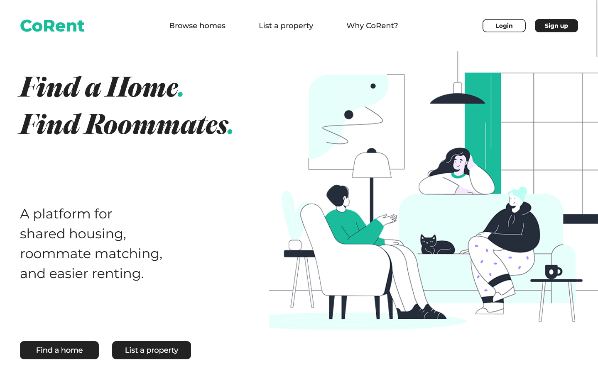
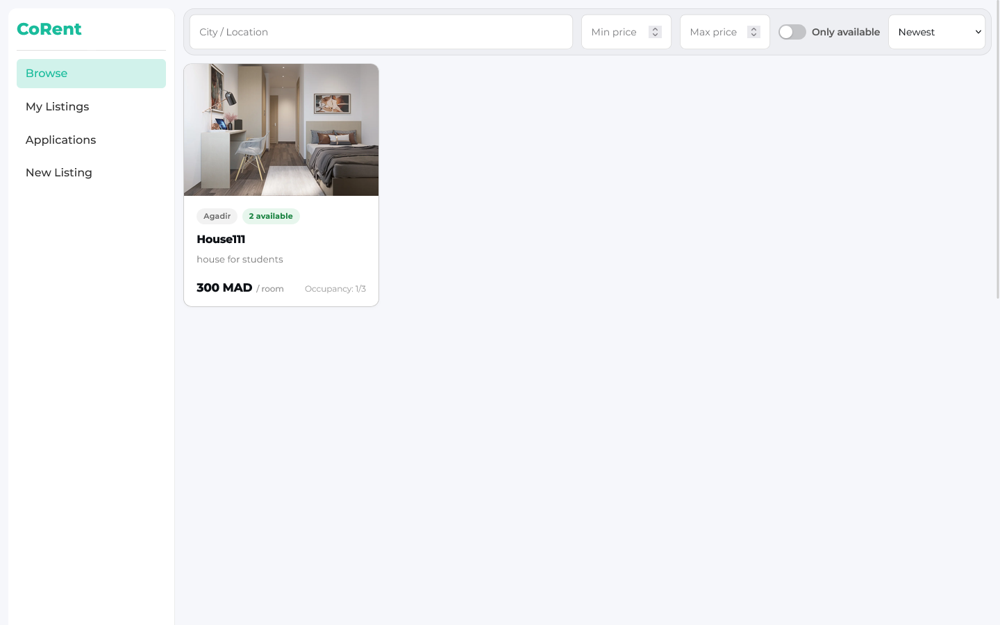
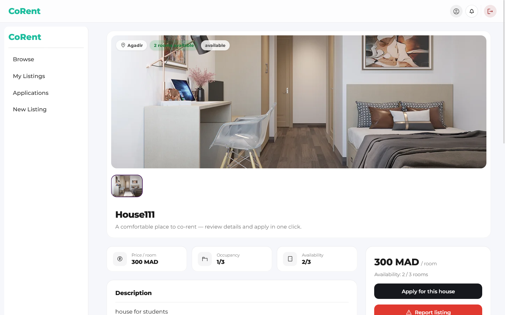
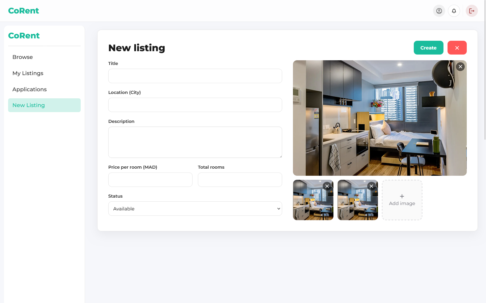
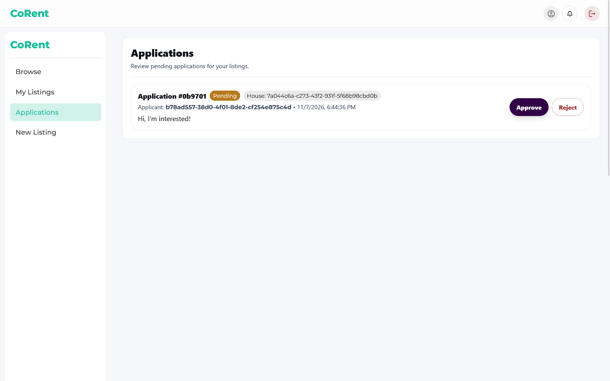
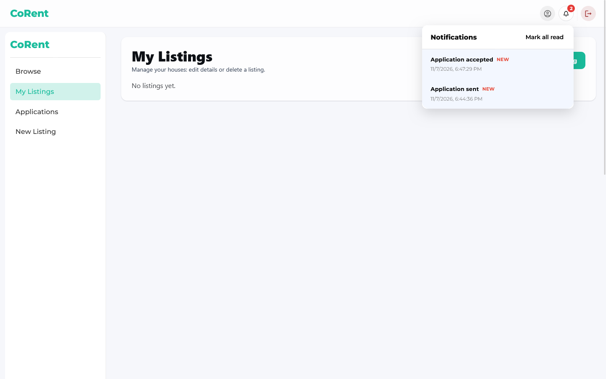
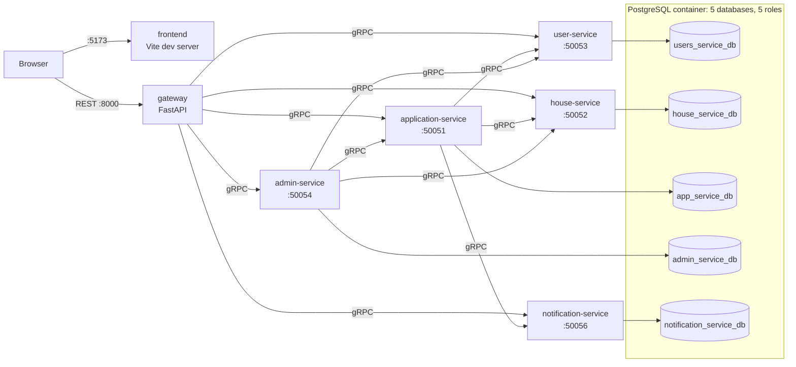

# CoRent

**A housing co-renting platform that connects students looking for accommodation with homeowners looking for tenants.**

CoRent is a full-stack, microservice-style project: a React frontend, a FastAPI REST gateway, five gRPC backend services, and one PostgreSQL database per service, all runnable locally with Docker Compose.

> **Project status.** CoRent started as a five-person university assignment for a distributed-systems module. It was later reworked by one author (frontend rebuilt, backend restructured, repository cleaned up, Docker setup added). It is a **portfolio project for local development**, not a production service. See [Known limitations](#known-limitations).

[English](README.md) | [Français](README.fr.md)

## Screenshots

| Landing page | Browse houses |
|---|---|
|  |  |

| House details | Create a listing |
|---|---|
|  |  |

| Owner reviews applications | Notifications |
|---|---|
|  |  |

More screens (login, signup, apply flow) are in [`docs/screenshots/`](docs/screenshots/).

## Why CoRent

Finding housing is difficult, costly and uncertain, especially at the start of the academic year. CoRent aims to make that search easier: homeowners list rooms in a shared house, students browse and apply, and owners accept or reject applications.

## Features

| Feature | Status |
|---|---|
| Sign up (3-step form) and log in | Verified in Docker |
| Create a listing (with image URLs) | Verified in Docker |
| Browse listings; view them from another account | Verified in Docker |
| Apply to a listing; owner approves | Verified in Docker |
| In-app notifications ("Application sent", "Application accepted") | Verified in Docker, see [limitations](#known-limitations) |
| Edit/delete listings, reject applications, profile, browse filters | Reported working by the author; not re-tested in Docker |
| Report a listing | Implemented; not re-tested in Docker |
| Admin dashboard, listing moderation, user banning | Accessible but **buggy** (author-reported); not tested in Docker |

"Verified in Docker" means exercised manually in the browser against the Compose stack (November 2026). There is no automated test suite (see [Testing](#testing)).

## Technologies

- **Frontend:** React 19, Vite 7, Material UI 7, React Router 7, axios, GSAP
- **Gateway:** FastAPI (REST), calling the services over gRPC
- **Services:** Django 6.0 (user, house, application, admin) and SQLAlchemy (notification), communicating through gRPC and Protocol Buffers
- **Database:** PostgreSQL 16 (Docker), one database per service
- **Tooling:** Docker Compose; Python 3.12 in the containers; Node 22 for the frontend container

Dependency versions are pinned per service in each `requirements.txt` and in `frontend/package-lock.json`.

## Architecture



The browser talks only to the frontend and the gateway. The gRPC services and PostgreSQL are reachable only inside the Docker network.

### Services

| Service | Stack | gRPC port | Database | Responsibility |
|---|---|---|---|---|
| `gateway` | FastAPI | HTTP 8000 | none | REST API for the frontend; forwards calls to the services |
| `user-service` | Django | 50053 | `users_service_db` | Accounts, authentication (JWT), profiles |
| `house-service` | Django | 50052 | `house_service_db` | Listings and their image URLs |
| `application-service` | Django | 50051 | `app_service_db` | Rental applications, accept/reject; calls user, house and notification services |
| `admin-service` | Django | 50054 | `admin_service_db` | Admin operations (moderation, user bans) |
| `notification-service` | SQLAlchemy | 50056 | `notification_service_db` | Stores and serves notifications |
| `frontend` | React + Vite | HTTP 5173 | none | User interface |

Service-to-service calls to the user service use a shared secret (`INTERNAL_GRPC_KEY`). gRPC traffic inside the Docker network is not encrypted.

## Getting started (Docker)

### Prerequisites

- Git
- Docker with Compose v2 (Docker Desktop on Windows/macOS, or Docker Engine + the Compose plugin on Linux)
- Python 3 or OpenSSL, only to generate random secrets

The setup was tested on Windows with Docker Desktop. Other platforms are untested.

### 1. Clone and configure

```bash
git clone https://github.com/IJJ01/Corent.git
cd Corent
cp .env.example .env
```

Open `.env` and replace every `change-me` with a **different** random value. To fill them all automatically:

```bash
python - <<'EOF'
import secrets
out = []
for line in open(".env"):
    if "=" in line and not line.startswith("#"):
        line = line.split("=", 1)[0] + "=" + secrets.token_urlsafe(32) + "\n"
    out.append(line)
open(".env", "w").writelines(out)
EOF
```

`.env` is ignored by Git. Never commit it.

| Variable | Used by |
|---|---|
| `POSTGRES_PASSWORD` | PostgreSQL superuser |
| `USER_DB_PASSWORD`, `HOUSE_DB_PASSWORD`, `APP_DB_PASSWORD`, `ADMIN_DB_PASSWORD`, `NOTIF_DB_PASSWORD` | One database role per service |
| `DJANGO_SECRET_KEY_USER`, `DJANGO_SECRET_KEY_HOUSE`, `DJANGO_SECRET_KEY_APPLICATION`, `DJANGO_SECRET_KEY_ADMIN` | Django secret key of each service |
| `JWT_SECRET` | Signs login tokens (user-service) |
| `INTERNAL_GRPC_KEY` | Shared secret for internal gRPC calls |

### 2. Start

```bash
docker compose up -d --build --wait
docker compose ps
```

The first build downloads base images and packages and takes a few minutes. When it finishes, all eight containers should show `(healthy)`.

### 3. Use it

| What | URL |
|---|---|
| Application | http://localhost:5173 |
| REST API docs (Swagger UI) | http://localhost:8000/docs |
| Gateway health check | http://localhost:8000/health |
| Gateway-to-user-service gRPC check | http://localhost:8000/health/grpc |

Only the frontend and the gateway are published, and only on `127.0.0.1`. The database starts **empty**: create an account through the signup page.

### 4. Stop and restart

```bash
docker compose stop          # stops containers, keeps your data
docker compose up -d --wait  # starts them again
```

Data lives in the named volume `corent_pgdata`.

> **Careful:** `docker compose down -v` deletes the database volume and all your data. Plain `docker compose down` removes the containers but keeps the data.

## Database initialization

Docker Compose handles it. On the **first start with an empty volume**, PostgreSQL runs two scripts:

1. [`scripts/init_db.sql`](scripts/init_db.sql) creates the five databases.
2. [`docker/postgres/02-roles.sh`](docker/postgres/02-roles.sh) creates one login role per service, owning its own database, with `CONNECT` revoked from `PUBLIC`.

Then, at container start:

- The four Django services run `manage.py migrate` (safe to repeat; it does not reset data).
- The notification service creates its table at startup with SQLAlchemy `create_all`. An Alembic migration exists in the repository but is not used at runtime.

Notes:

- PostgreSQL runs init scripts only once. If you change a `*_DB_PASSWORD` in `.env` after the first start, the existing roles keep their old passwords. To start over you must delete the volume (`docker compose down -v`), which erases your data.
- Five databases on one server give **logical** separation (separate schemas, no cross-database queries, one role per database). They do not give fault or resource isolation. Five separate PostgreSQL containers would be needed for that.
- No seed data is created, and creating an admin account is not covered by this setup.

## Development workflow

- The `frontend` container runs the Vite dev server but does not mount the source folder, so code changes need a rebuild: `docker compose up -d --build frontend`.
- For hot reload while working on the UI, run the frontend on your machine instead (not re-tested after the Docker migration):
  ```bash
  docker compose stop frontend
  cd frontend
  cp .env.example .env
  npm install
  npm run dev
  ```
- `python start.py` is the original launcher. It is **Windows-only**, expects local virtual environments per service and a local PostgreSQL, and is kept for reference. It is not part of the verified setup.

## API and gRPC

- **REST:** the gateway serves interactive OpenAPI documentation at http://localhost:8000/docs while the stack is running. Route groups: `/auth`, `/houses`, applications, `/me`, `/reports`, `/notifications`, `/admin`, `/admin/reports`, and `/health`.
- **gRPC:** the service contracts are the Protocol Buffers files in [`shared/protos/`](shared/protos/) (`user`, `house`, `application`, `admin_service`, `notification`). Generated Python code is committed in [`shared/generated/`](shared/generated/).
- There is no Postman collection in this repository.

## Testing

There is **no automated test suite and no CI**.

- Each service has a `tests/` folder with manual gRPC client scripts written during development. They connect to `127.0.0.1:<port>`, so they do not run against the Docker stack as they are, and they were not run as part of the Docker verification.
- The `tests.py` file of each Django service is an empty stub.

What was verified, manually, against the Docker stack:

| Check | Result |
|---|---|
| All eight containers reach `healthy` | Pass |
| Database roles can connect only to their own database | Pass |
| Data survives `docker compose stop` and `docker compose down` | Pass |
| Gateway reaches the user service over gRPC (`/health/grpc`) | Pass |
| Signup, login, create listing, view it from another account | Pass |
| Apply, approve, notifications created and displayed | Pass |
| Fresh clone with a newly generated `.env` starts and allows signup and login | Pass |
| Admin dashboard, reports, user banning | Not tested |

## Known limitations

**Security** (the most important point; do not expose this stack to an untrusted network):

- The gateway identifies the caller from an `x-user-id` header supplied by the client, without verifying the JWT, on the house, application and notification routes I inspected.
- Admin routes only require that an `x-admin-id` header is present. In the admin service, the only check I found is that the value is a valid UUID.
- Services talk gRPC without TLS.

**Product and UI:**

- The admin dashboard is buggy (author-reported) and untested in Docker.
- Notifications are fetched by polling every 20 seconds, so they can appear with a delay. The code creates notifications for the applicant only; the owner is not notified of new applications. Other notification issues reported by the author have not been investigated.
- Listings store image **URLs**. There is no file upload, although the "Add image" control may suggest one.
- When there are no listings (or the request fails), the browse page shows built-in demo houses with the banner "API Gateway not reachable".
- "Continue with Google" on the login page is a non-functional placeholder.
- The owner's applications page shows raw user and house IDs rather than names.

**Engineering:**

- No automated tests, no CI, and no production deployment configuration. Docker is for local development.
- Dependency versions differ between services (each is pinned separately). The gateway and the notification service were developed on Python 3.14; the Docker images use Python 3.12.
- The original team commit history is not part of this repository (see below).

## Project history and contributions

**Phase 1: team project (university).** CoRent began as a five-person assignment for a distributed-systems module:

| Contributor | Contribution |
|---|---|
| Houssam Ijjaali | Application service and integration, system design, tests, team lead |
| Mohamed Bailla | House service, house pages (frontend) |
| Mohamed Iknioun | User service, authentication, and their frontend |
| Alaa Eddin Benslimane | Admin service and admin frontend |
| Abdellah Rahel | Notification service |

**Phase 2: solo rework (2026), by Houssam Ijjaali.**

- Rebuilt the frontend.
- Restructured and refactored the backend.
- Cleaned up the repository: removed committed virtual environments and secrets, rewrote the history, added `.gitignore` and `.env.example` templates, pinned dependencies, fixed a Django 6 migration incompatibility.
- Added the Docker Compose setup, with one database role per service and health checks.

This repository starts from the cleaned-up version, so the original per-author commit history is not included. The table above is the record of who built what.

## License

Licensed under the Apache License 2.0. See [LICENSE](LICENSE) and [NOTICE](NOTICE).

Copyright 2026 Houssam Ijjaali and the contributors listed above.
